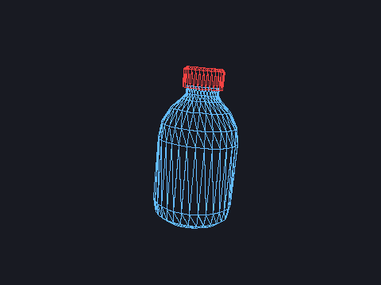
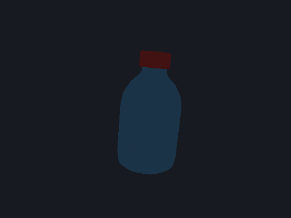
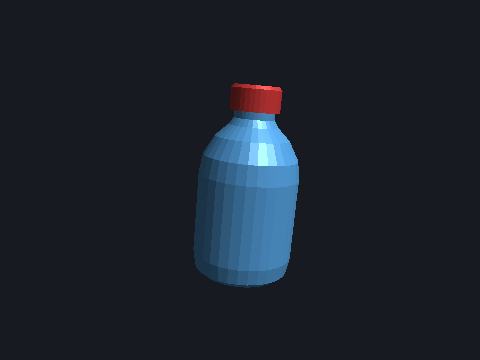
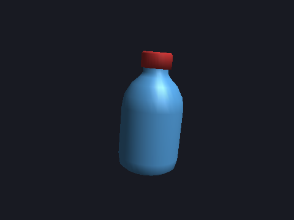

# Render 3D de una botella (pipeline propio en Python)

Proyecto de graficación: una botella de agua con tapa, modelada en Blender (`.obj`) y dibujada por un
pipeline de renderizado programado **desde cero**, sin OpenGL ni librerías de graficación.
`pygame` solo se usa para abrir la ventana y mostrar el búfer de píxeles ya calculado.

| Alambre | Ambiental | Plano | Gouraud |
|---|---|---|---|
|  |  |  |  |

## Uso

```bash
pip install -r requirements.txt
python main.py                       # ventana interactiva
python main.py --guardar foto.png    # un cuadro a PNG, sin ventana ni pygame
python main.py --obj assets/botella.obj --ancho 480 --alto 360 --zoom 2
```

| Tecla | Acción |
|---|---|
| `1` `2` `3` `4` | alambre, ambiental, plano, Gouraud |
| Flechas | rotar la botella |
| `W A S D` / `Q E` | mover en pantalla / acercar y alejar |
| `Espacio` | activar o pausar la rotación automática |
| `R` / `Esc` | reiniciar / salir |

El render es en Python puro, así que se mantiene a baja resolución (320x240 ampliado x2). Si va lento, baja `--ancho` y `--alto`.

## Pipeline

```
.obj ──► coordenadas del OBJETO ──(matriz de modelo)──► MUNDO ──(look-at)──► CÁMARA
     ──(perspectiva + división entre w + viewport)──► PANTALLA ──► rasterizado + iluminación
```

| Etapa | Archivo (`graficacion/`) |
|---|---|
| Lectura del .obj y normales por vértice | `cargar_obj.py` |
| Objeto → mundo (`T·Ry·Rx·S`) | `coordenadas_mundo.py`, `matrices.py` |
| Mundo → cámara (look-at) | `coordenadas_camara.py` |
| Cámara → pantalla | `coordenadas_pantalla.py` |
| Líneas (Bresenham) | `linea_bresenham.py` |
| Triángulos (baricéntricas + z-buffer) | `rasterizar_triangulo.py`, `framebuffer.py` |
| Iluminación | `luz_ambiental.py`, `luz_difusa.py`, `luz_especular.py` |
| Sombreado | `sombreado_plano.py`, `sombreado_gouraud.py` |
| Orquestación del cuadro | `renderizar.py` |
| Parámetros (cámara, luz, colores) | `config.py` |

## Modelos de iluminación

- **Ambiental:** intensidad constante `ka`; se ve la silueta sin relieve.
- **Plano:** una sola iluminación por triángulo con la normal de la cara (ambiental + Lambert + brillo).
- **Gouraud:** se ilumina en cada vértice con su normal suave y el color se interpola dentro del triángulo con coordenadas baricéntricas.

## Modelo 3D (Blender)

`assets/botella.obj` es una botella de respaldo generada con `herramientas/generar_botella_obj.py`
(sólido de revolución con el origen en la base). **Reemplázala por tu modelo de Blender:**

1. Perfil de la botella con el origen en la base `(0,0)` y la tapa como objeto aparte llamado `Tapa`.
2. Modificador *Screw* sobre el eje vertical (o Spin) para generar la malla.
3. `File > Export > Wavefront (.obj)` con *Triangulate Faces* y *Objects as OBJ Objects* activados.
4. Que el eje vertical sea Y (opción *Forward: -Z, Up: Y*). Guarda el archivo como `assets/botella.obj`.

El cargador lee `v`, `o`/`g` y `f` (triangula caras de más de 3 lados). Los objetos cuyo nombre contenga «tapa» salen en rojo; ajusta colores en `config.py`.

## Pruebas

```bash
python -m unittest discover -s tests -v
```

## Autores

Nombres del equipo: _completar_
